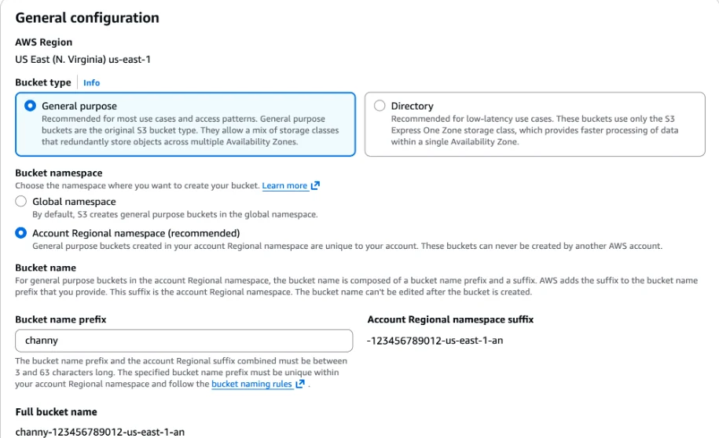

# 86. A note about S3 regional namespaces

In March 2026 AWS relaxed the requirement that **S3 bucket names are globally unique**, with **account regional namespaces**.

- You can create buckets within your own reserved namespace.
- When creating a bucket you choose a **global** or **account regional** namespace, with account regional the new recommended default.
- Under the hood, the bucket name gets a suffix unique to your account and region.

- Earlier videos that mention globally unique bucket names will be updated over time. There is now an option to get around that constraint.
- The exam will take several months to reflect changes like this, and it is unlikely to test S3 bucket naming anyway.
